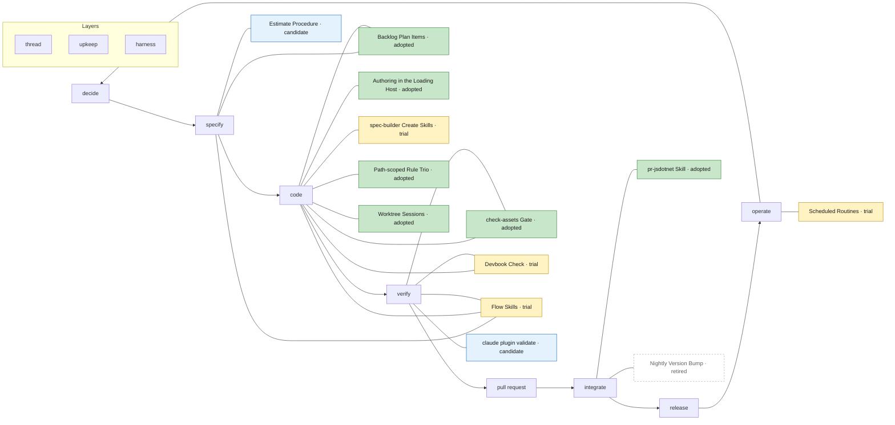

# AI Adoption Map

```meta
rating: trial
type: adoption-map
```

> This map records how this marketplace is built with AI. Agents author every asset here, so the record says
> which ways of working are settled and which are still being tried.

## How the Loop Reads Here

This repository ships Markdown and JSON that two hosts load, and it deploys and operates
nothing. Merging to `main` is the release, because the marketplace installs from `main`. So
`code` through `integrate` carry almost everything: `code` is authoring an asset, `verify` is
checking it, and `integrate` is the pull request and the version.

| File | Covers |
| --- | --- |
| [01-authoring.md](01-authoring.md) | Writing an asset: the loading host, spec-builder's contracts, the rule trio |
| [02-carrying-a-change.md](02-carrying-a-change.md) | Backlog plans and estimates, delivery flows, worktree sessions, the pull request, the version, scheduled routines |
| [03-checking.md](03-checking.md) | `check-assets.mjs`, `claude plugin validate`, and the devbook check |

## Adoption Picture



`decide` and `release` are empty. No chapter records a usage at `decide`, and nothing here is
compiled or deployed, so `release` has no work beyond the merge. `operate` holds one usage on
trial: the local scheduled routines, of which one has published so far. The three layers hold no
chapter yet.

`claude plugin eval` is not recorded. No plugin here has an eval suite and no session has run
one, so it gets a chapter when one does.

## Reading and Extending

`rating` is the adoption ladder in `devbook-ai.md`: `candidate`, `trial`, `adopted`, `hold`,
`retired`. It rates the way of working, not the tool. The tool's own rating is in
`.devbook/tech/`. `date` is the day the current rating was set.

To add a usage:

1. Add a `##` chapter in the file for the part of the flow it serves.
2. Point `depends-on` at its `tech/` chapter.
3. Add its box to the picture above in the same change.
4. Run `node .devbook/_tools/devbook-meta/build.mjs --check`.
