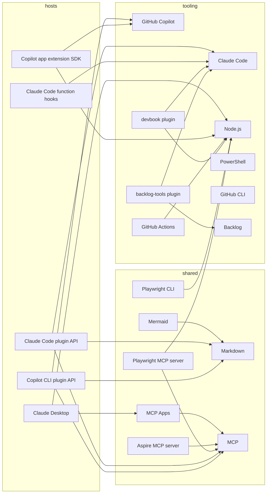

# Technology Graph

```meta
rating: adopted
```

> This graph records the technologies this marketplace is built, carried, and checked with. It ships no
> runtime of its own: every plugin is Markdown and JSON loaded by two hosts, plus one MCP
> server and three canvases. What a specialist targets, such as Aspire, Playwright, Aikido, or
> Jira, is the consuming repository's stack and is not recorded here. The exceptions are the
> MCP servers this repository's own manifests declare and the Playwright CLI the `qa` plugin runs.

## Layers

| File | Covers |
| --- | --- |
| [shared.md](shared.md) | Asset formats, tool server protocols, the declared MCP servers, and the Playwright CLI |
| [hosts.md](hosts.md) | Both hosts' plugin contracts, the host plugins' two apps, and Claude Code function hooks |
| [tooling.md](tooling.md) | Authoring and loading agents, script runtime and shell, CI, and the plugins and apps carrying a change |

## Graph



## Reading and extending

`rating` is the tech-radar ladder in `devbook-tech.md`: `candidate`, `trial`, `adopted`,
`hold`, `retired`. It rates each technology in this repository.

To add a technology:

1. Add a `##` chapter in the layer that owns it.
2. Add its node and its `depends-on` edges here in the same change.
3. Run `node .devbook/_tools/devbook-meta/build.mjs --scope tech --check`.

Package facts come from the inventory scripts under `.devbook/_tools/devbook-tech/`. This
repository has no .NET projects and three `package.json` files, and only the canvases carry a
dependency.
