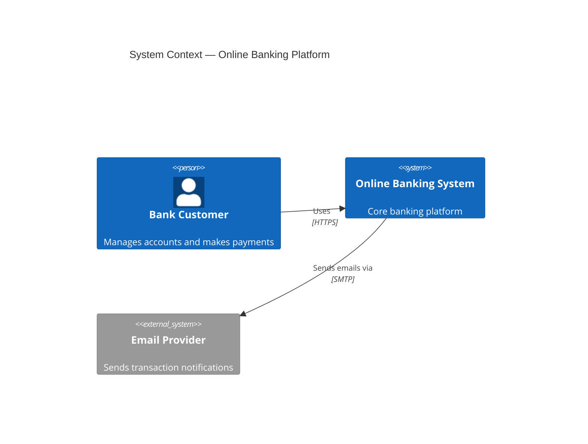

# C4 Model — Global Instructions

Prose follows `prose.md`; where the diagram lands and what goes beside it, `diagram-output.md`.

## Notation Standards

### Relationship Conventions

- Label every relationship with a verb phrase (e.g., "reads data from", "sends events to").
- Specify protocol or technology when relevant (e.g., HTTPS, gRPC, AMQP, SQL).
- Use directional arrows; draw a bidirectional arrow only when the interaction is truly symmetric.
- Do not draw inferred relationships — only model what is architecturally significant.

### Naming Conventions

- Use short, meaningful names for all elements (maximum 3 words).
- Use bracketed technology labels in container and component diagrams (e.g., `[React SPA]`, `[PostgreSQL]`).
- Distinguish internal from external elements using the `_Ext` variants.

## Color Conventions

Apply this palette consistently across every C4 diagram using Mermaid's `UpdateElementStyle(alias, $bgColor="...", $fontColor="...", $borderColor="...")` directive. Color is additive — it reinforces the `_Ext` naming convention and element type, it never replaces the text label.

| Element Type | Background | Border | Font | Meaning |
| --- | --- | --- | --- | --- |
| `Person` (internal) | `#1168BD` | `#0B4884` | `#FFFFFF` | In-scope human actor |
| `Person_Ext` | `#999999` | `#6B6B6B` | `#FFFFFF` | External human actor |
| `System` (in scope) | `#1168BD` | `#0B4884` | `#FFFFFF` | The system being described |
| `System_Ext` | `#999999` | `#6B6B6B` | `#FFFFFF` | External/third-party system |
| `Container` | `#438DD5` | `#2E6295` | `#FFFFFF` | Runnable/deployable unit |
| `ContainerDb` | `#438DD5` | `#2E6295` | `#FFFFFF` | Data store container |
| `Component` | `#85BBF0` | `#5D82A8` | `#000000` | Logical component inside a container |

Note: Mermaid's C4 renderer emits no per-element ids/classes in its SVG output, so C4 diagrams are not interactively clickable in any Mermaid-based viewer (Mermaid `click` directives do not work on C4 elements). Colour is therefore the primary way to convey element type/scope at a glance for C4 diagrams regardless of how they are viewed.

### Example

The same directive styles containers and components at Levels 2 and 3, with their rows above.

## Mermaid Keyword per Level

| Level | Mermaid Keyword |
| --- | --- |
| System Context | `C4Context` |
| Container | `C4Container` |
| Component | `C4Component` |
| Code | `classDiagram` (standard UML class notation) |

## Scope Guidelines

- Level 1: one diagram per project is usually sufficient.
- Level 2: one diagram per system; add a separate diagram per bounded context when the system is large.
- Level 3: one diagram per container; focus on architecturally significant containers.
- Level 4: use sparingly; only for components with non-obvious class structure or critical design decisions.
- Add a note block for any symbol or convention outside this file.
