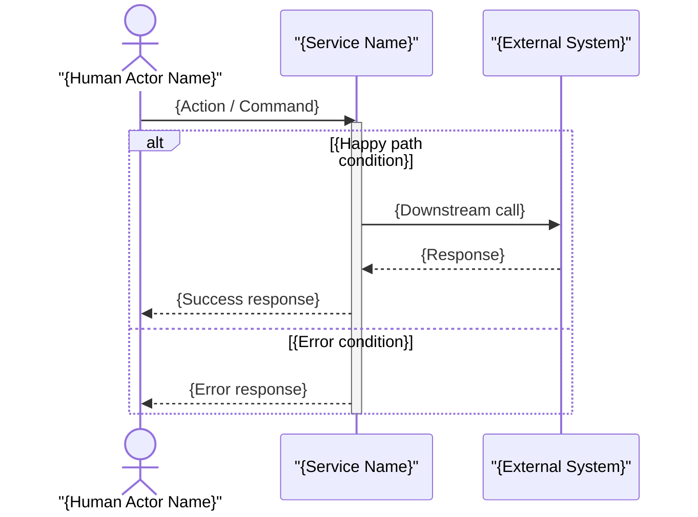

# Sequence Diagram Prompt

## Pre-Draft Checklist

Confirm the following before generating the diagram:

1. What is the name of the scenario? (e.g., "Customer places order", "Password reset flow")
2. Who is the initiating actor or system?
3. Which participants are involved? (services, components, databases, external systems, human actors)
4. What messages are exchanged, and in what order?
5. Are any messages asynchronous (fire-and-forget, event-driven)?
6. What are the significant error or alternative paths?
7. Are there any loops (polling, retry) or parallel operations?

## Mermaid Template

## Guidance

- Use `-)` for async fire-and-forget messages (no reply expected); reserve `-x` for a failed or rejected message.
- Keep the participant list to the minimum needed for this scenario.

## Output Requirements

- One `sequenceDiagram` fenced `mermaid` code block with a `%% Scenario:` comment header.
- All messages labelled with a verb phrase.
- Synchronous and asynchronous arrows used correctly.
- At least the happy path shown; significant error path included where architecturally relevant.

The summary, links, assumptions, and SVG follow [diagram-output.md](../../../resources/diagram-output.md).
